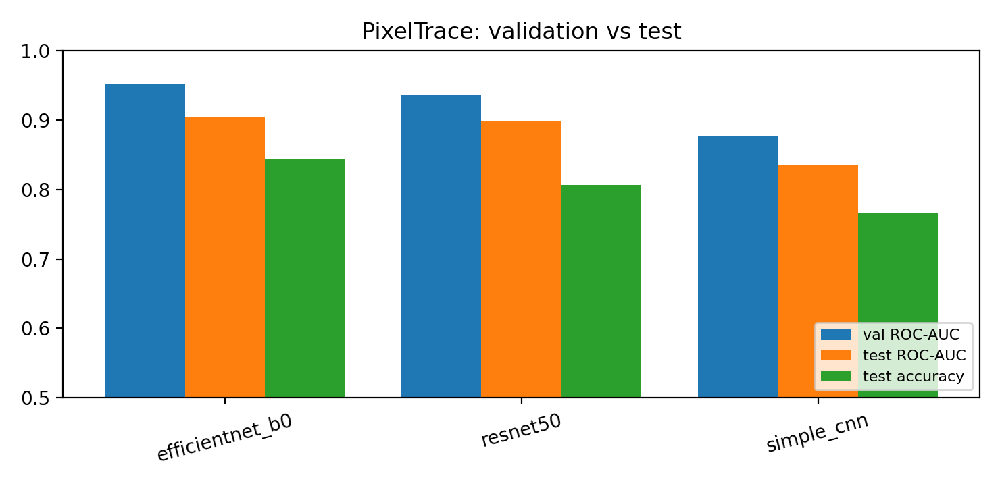

# PixelTrace: AI-Generated Image Detection

Classifying AI-generated vs real images with CNNs and transfer learning, using an audited evaluation protocol: fixed, de-duplicated splits, model selection on validation only, probability-based metrics with confidence intervals, robustness tests and Grad-CAM.

This project started as a set of Colab notebooks that reported **93–99.6 % accuracy**. An audit found a leaky train/test split, every image stored twice, and labels that file metadata alone predicts with **97.7 %** test accuracy. PixelTrace rebuilds the experiment from the data up and reports what a model achieves once those problems are removed.

**Author:** Abir Ahmmed ([devbyabir](https://github.com/devbyabir))

---

## Audit of the original notebooks

| Problem | Effect | Fix in PixelTrace |
|---|---|---|
| Split made with `take()`/`skip()` on a dataset that reshuffles every epoch | Test images can be seen during training | Fixed, file-level, stratified split stored in a manifest |
| 3,998 files but only 2,000 distinct images (1,998 stored twice, 2 once) | The same picture can sit in train and test | Exact (SHA-256) and near-duplicate (dHash) removal **before** splitting |
| Test set used as `validation_data`; last epoch saved | Model selection on test data | Separate validation split; best checkpoint by val ROC-AUC; test evaluated once |
| AI images 62 % square / 36 % PNG / 52 % EXIF vs real 0.8 % / 0.1 % / 9.5 % | Labels predictable from non-content cues | Square centre-crop, JPEG re-encode, metadata stripped |
| "MobileNet" notebook trained ResNet-50; ViT never run; ROC-AUC from hard labels; no model-specific preprocessing | Comparison not valid | One config per model; timm normalisation; probability-based metrics |

**Shortcut-risk check** ([`results/data_audit.md`](results/data_audit.md)): a logistic regression on file metadata only (aspect ratio, resolution, PNG/JPEG, EXIF, file size), fitted on the train split, reaches **97.7 % test accuracy** (ROC-AUC 0.982) on the raw files. This shows the labels were predictable without looking at image content, a risk for any model trained on the raw files. It does **not** show what the legacy CNNs actually learned. After cleaning, the remaining file-size cue gives **54.3 %**. That removes these particular cues; it does not prove that no shortcut remains (see [Limitations](#limitations)).

## Results

<!-- RESULTS:START -->
Test split: 300 images, evaluated once with the checkpoint chosen on validation. Deployment model, chosen by validation ROC-AUC: **EfficientNet-B0 (ImageNet-pretrained)**.

| Model | Params (M) | Val ROC-AUC | Test accuracy (95 % CI) | Macro-F1 | AI precision / recall | Test ROC-AUC (95 % CI) | ROC-AUC @ JPEG q50 |
|---|---|---|---|---|---|---|---|
| EfficientNet-B0 (ImageNet-pretrained) | 4.0 | 0.952 | 0.843 (0.803–0.887) | 0.843 | 0.855 / 0.827 | 0.904 (0.866–0.940) | 0.886 |
| ResNet-50 (ImageNet-pretrained) | 23.5 | 0.935 | 0.807 (0.763–0.850) | 0.807 | 0.807 / 0.807 | 0.897 (0.859–0.931) | 0.891 |
| Simple CNN (from scratch) | 3.1 | 0.877 | 0.767 (0.720–0.813) | 0.767 | 0.778 / 0.747 | 0.835 (0.788–0.881) | 0.830 |



Trained with PyTorch 2.14.1+cu130 / timm 1.0.31 on Tesla T4. Verification (`results/verification.json`): **all checks passed**. ONNX vs PyTorch on the test split: max |ΔP(AI)| = 5.5e-06.

Per-model training curves, confusion matrices, ROC curves, robustness curves and per-image test predictions are in `results/runs/<model>/`. Grad-CAM overlays and error grids contain dataset images and are not published.
<!-- RESULTS:END -->

**Reading the results**

- After the leakage, duplicate and shortcut fixes, test accuracy is **77–84 %**, not the 93–99.6 % the legacy notebooks reported.
- Pretrained backbones beat the from-scratch CNN. The EfficientNet-B0 and ResNet-50 confidence intervals overlap heavily, so this test set can't separate those two. EfficientNet-B0 is deployed because it had the higher **validation** ROC-AUC, and it is also about 6× smaller.
- **Robustness (EfficientNet-B0, `results/runs/efficientnet_b0/robustness.csv`):** ROC-AUC goes from 0.904 on clean images to 0.869 at JPEG q30, 0.841 at ×0.25 down-scaling and 0.851 with blur radius 2. The errors are one-sided: AI recall falls from 0.827 to 0.67 while real-image recall stays at 0.84–0.89. Degraded AI images tend to be scored as real, the failure mode that matters for re-shared social-media images.

## Method

- **Data:** 2,000 unique images (1,000 AI / 1,000 real) split 1,400 / 300 / 300 (seed 42), see [DATASET.md](DATASET.md). [`results/manifest/`](results/manifest) records the split and the raw and processed SHA-256 for each image (no pixels).
- **Preprocessing:** RGB, aspect-preserving resize plus centre crop to 512² (Lanczos), JPEG q95, no metadata. `pixeltrace.preprocess.normalise` is used for both training data and inference on new files.
- **Training:** AdamW, cosine schedule with warm-up, mild geometric augmentation only (colour and blur augmentation would also erase generator artifacts), early stopping on validation ROC-AUC.
- **Evaluation:** accuracy, balanced accuracy, macro-F1, AI-class precision and recall, ROC-AUC and average precision from probabilities, and 1,000-sample bootstrap 95 % CIs.
- **Robustness:** test performance under JPEG re-compression (q 90 → 30), down-scaling (×0.75 → ×0.25) and Gaussian blur.
- **Explainability:** Grad-CAM for the "AI" class. Overlays are kept private because they show dataset images.
- **Deployment model:** chosen by validation ROC-AUC, exported to ONNX and checked against PyTorch (`results/onnx/onnx_parity.json`).

## Reproduce

Requirements: Python ≥ 3.10; a GPU is recommended for training. Exact versions from the reported run are in [`requirements-lock.txt`](requirements-lock.txt) and `results/environment/`.

```bash
pip install -r requirements.txt && pip install --no-deps -e .
# data (not distributed): put it in data/raw/{AI Generated,Real}/ (see DATASET.md), then
python scripts/prepare_data.py                                    # audit + clean + split
python scripts/verify_manifest.py --reference-digest results/manifest/digest.json \
       --candidate results/manifest/splits_manifest.csv           # same split as the reported run?
python scripts/colab_pipeline.py --mode smoke --skip-data         # whole pipeline on 64 images
python scripts/colab_pipeline.py --mode full  --skip-data --backup /path/to/persistent/folder  # train, evaluate, export, verify
python -m pixeltrace.inference --run results/runs/<model> my_image.jpg
```

On Colab, [`notebooks/pixeltrace_colab.ipynb`](notebooks/pixeltrace_colab.ipynb) runs the same pipeline. Full training refuses to start without a verified persistent backup (Google Drive): the best checkpoint is copied there on every validation improvement, and each finished model as soon as it completes. Every step stops on the first error, and `pixeltrace.verify` fails unless all artifacts exist and agree: checkpoint reload, raw-file inference, metrics vs saved predictions, validation-based deployment choice and ONNX parity.

## Browser demo

[`docs/`](docs) is a static showcase page (GitHub Pages-ready). It runs the deployed ONNX model with ONNX Runtime Web, so images stay on the visitor's device. The browser preprocessing is a port of the Python pipeline, including Pillow's fixed-point resampler, and [`docs/parity.html`](docs/parity.html) checks it stage by stage against Python on synthetic test patterns. The page shows model scores, not proof that an image is authentic.

## Repository layout

```
configs/                  one YAML per model (optional/ = extra backbones)
scripts/                  prepare_data, verify_manifest, colab_pipeline, make_reference_images
src/pixeltrace/           data, models, train, metrics, robustness, gradcam, compare, export_onnx, verify, inference
notebooks/                Colab notebook
results/                  audit, manifest, per-run metrics/plots/predictions, environment (no checkpoints)
docs/                     showcase website + browser demo + parity page
tools/                    site/README builders, parity test vectors, Colab bundle
legacy/                   original notebooks (outputs kept, dataset-image outputs removed)
```

## Limitations

- **Small, single-source dataset** of 2,000 images from unknown generators. Results say nothing about other generators, edits or real-world photo pipelines.
- **Residual confound:** real photos were downscaled from much higher resolutions (median 1.75 MP, up to ~100 MP) than the AI images (median 1.05 MP). Resampling leaves different high-frequency statistics that a model may exploit. Cleaning removes the format, shape and metadata cues, not this one.
- **Small test set** (300 images): see the confidence intervals. Differences between models inside them are not meaningful.
- **Unknown dataset licence:** no dataset images or image-derived figures are published.

## Credits and licence

- Author: **Abir Ahmmed (devbyabir)**. The legacy notebooks are the author's earlier work.
- Dataset: received from a senior colleague. Original source and licence unknown, see [DATASET.md](DATASET.md).
- Built with [PyTorch](https://pytorch.org/), [timm](https://github.com/huggingface/pytorch-image-models) (pretrained ImageNet weights), [ONNX Runtime](https://onnxruntime.ai/) and [Pillow](https://python-pillow.org/). The browser resampler follows Pillow's `libImaging/Resample.c`.
- **No open-source licence.** © Abir Ahmmed, all rights reserved. You may view the code, but reuse requires permission.
